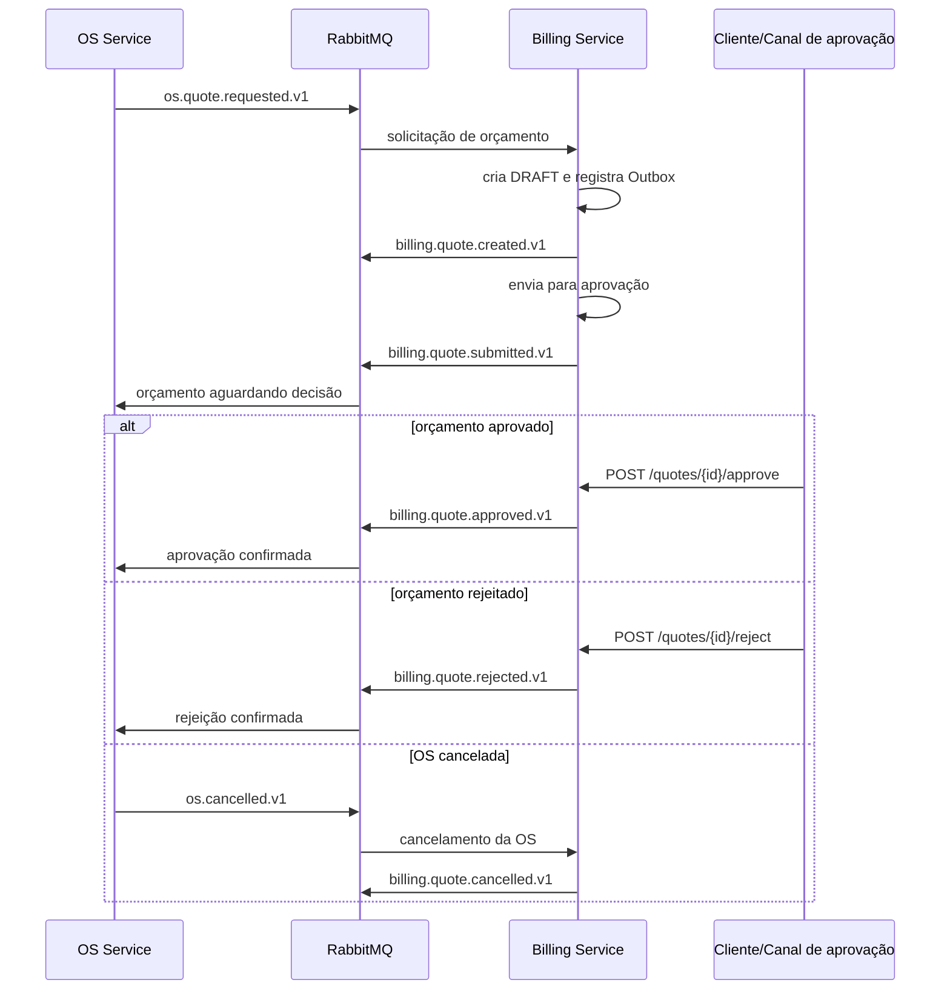
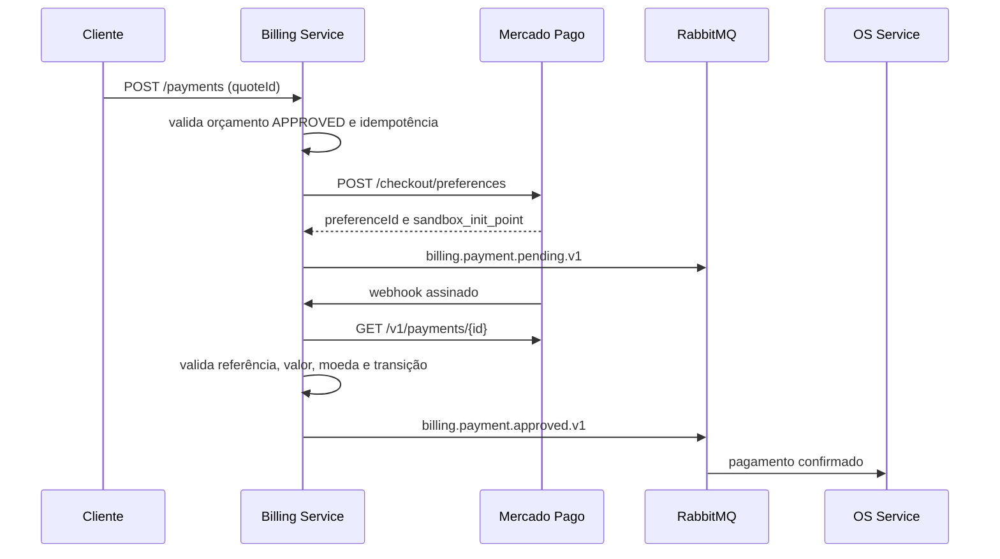

# Participação do Billing na Saga

## Escopo

O Billing é dono apenas dos estados de orçamento e pagamento. O OS Service é
dono da ordem de serviço e decide suas próprias transições ao consumir os fatos
publicados pelo Billing.

Inbox e Outbox são persistidos no mesmo banco MongoDB do Billing. As mudanças
de domínio, o registro da Inbox e a gravação da Outbox participam da mesma
transação local; por isso o MongoDB é executado como replica set.

### Pagamento após aprovação

O Billing cria a cobrança após a aprovação do orçamento e antes da execução:

O redirect do navegador nunca confirma o pagamento. Apenas um webhook com
assinatura válida, seguido de consulta autenticada ao provedor, altera o estado
financeiro.

## Contratos

A fonte oficial dos contratos é:

- [AsyncAPI](../contracts/asyncapi.yaml);
- [exemplos JSON](../contracts/examples/).

### Envelope obrigatório

| Campo | Regra |
| --- | --- |
| `eventId` | UUID único do evento |
| `eventType` | Nome versionado usado como routing key |
| `eventVersion` | Versão numérica do payload |
| `occurredAt` | Data UTC em ISO-8601 |
| `source` | Serviço que produziu o evento |
| `correlationId` | Identificador comum a toda a Saga |
| `causationId` | `eventId` que originou o evento, quando existir |
| `osId` | Identificador da ordem de serviço |
| `payload` | Dados específicos do evento |

### Eventos consumidos

| Evento | Produtor | Uso no Billing |
| --- | --- | --- |
| `os.quote.requested.v1` | OS Service | criar e enviar orçamento |
| `os.cancelled.v1` | OS Service | cancelar localmente quando permitido |

### Eventos publicados

| Evento | Significado |
| --- | --- |
| `billing.quote.created.v1` | orçamento persistido como rascunho |
| `billing.quote.submitted.v1` | orçamento enviado para aprovação |
| `billing.quote.approved.v1` | orçamento aprovado |
| `billing.quote.rejected.v1` | orçamento rejeitado |
| `billing.quote.cancelled.v1` | orçamento cancelado por cancelamento da OS |
| `billing.quote.failed.v1` | solicitação não processada definitivamente |
| `billing.payment.pending.v1` | preferência de checkout criada |
| `billing.payment.approved.v1` | pagamento confirmado pelo provedor |
| `billing.payment.rejected.v1` | pagamento rejeitado ou cancelado |
| `billing.payment.failed.v1` | falha de integração ou estado desconhecido |

## Topologia RabbitMQ acordada pelo Billing

| Recurso | Nome |
| --- | --- |
| Exchange de domínio | `mecanica.events` |
| Tipo | `topic`, durável |
| Queue de solicitação | `billing.os.quote-requested.v1` |
| Binding | `os.quote.requested.v1` |
| Queue de cancelamento | `billing.os.cancelled.v1` |
| Binding | `os.cancelled.v1` |
| Dead-letter exchange | `mecanica.events.dlx` |
| DLQs | `<queue>.dlq` |

Os valores serão externalizados para permitir nomes diferentes por ambiente.

### Garantias implementadas

- a Inbox usa `eventId` como chave única e ignora entregas repetidas;
- domínio, Inbox e Outbox são confirmados na mesma transação MongoDB;
- o publisher da Outbox aguarda a confirmação do RabbitMQ;
- falhas de publicação usam backoff e permanecem pendentes até o limite;
- listeners fazem quatro tentativas antes de encaminhar a mensagem para a DLQ;
- duplicidade após timeout é permitida, e os consumidores devem ser idempotentes.

## Regras de compatibilidade

- O nome do evento sempre contém a versão principal.
- Uma mudança que remove, renomeia ou altera o significado de um campo cria
  outro evento, por exemplo `billing.quote.approved.v2`.
- Campos novos e opcionais podem ser adicionados mantendo a mesma versão.
- Consumidores ignoram campos desconhecidos.
- Valores monetários usam decimal e moeda ISO 4217.
- Datas usam UTC e ISO-8601.
- O produtor nunca reutiliza um `eventId`.

## Falhas e compensações

| Situação | Ação do Billing | Resultado publicado |
| --- | --- | --- |
| Evento duplicado | Inbox reconhece e não repete efeito | nenhum novo efeito |
| Dados inválidos | rejeita após política definida | `billing.quote.failed.v1` |
| Orçamento rejeitado | registra decisão de negócio | `billing.quote.rejected.v1` |
| OS cancelada | cancela se o estado permitir | `billing.quote.cancelled.v1` |
| MongoDB indisponível | retry; sem ack da mensagem | evento volta para retry/DLQ |
| RabbitMQ indisponível após persistência | Outbox mantém evento pendente | publicação posterior |
| Retry esgotado | envia mensagem original para DLQ | alerta operacional |
| Evento fora de ordem | não executa transição inválida | retry ou DLQ conforme causa |

Rejeição não é falha técnica. Cancelamento e, futuramente, reembolso são
compensações explícitas; registros financeiros não devem ser apagados.

## Decisões ainda externas ao Billing

- estados internos da OS após cada evento;
- serviço que fornece peças, mão de obra e preços;
- política global após rejeição ou expiração;
- política de estorno após pagamento aprovado;
- cenário BDD final do grupo.

Essas decisões não alteram a responsabilidade local do Billing, mas precisam
ser fechadas para a demonstração ponta a ponta do grupo.
